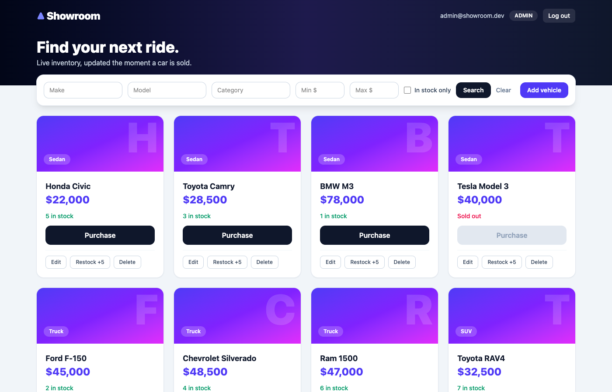
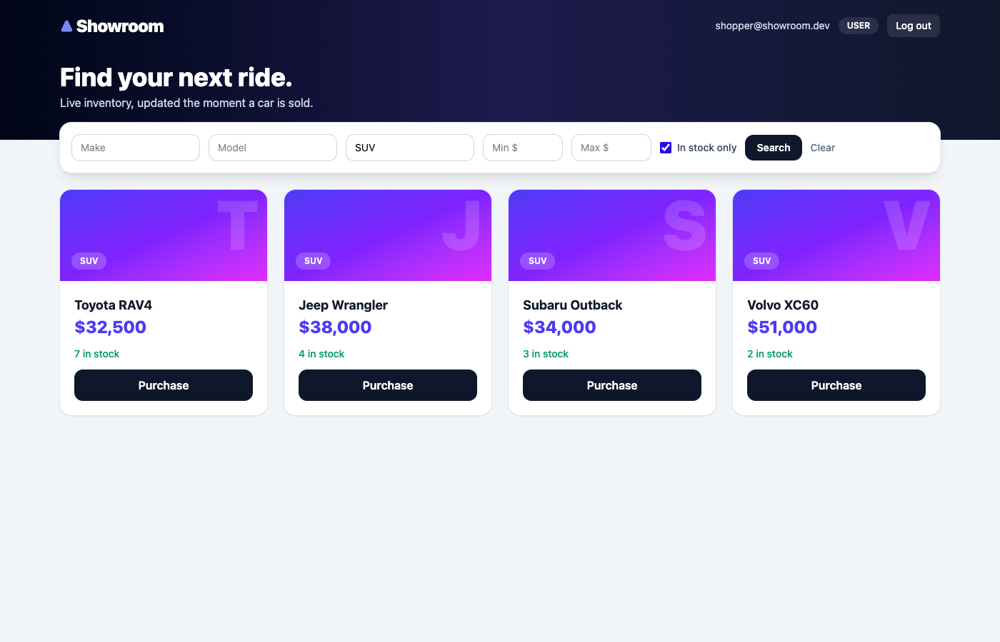

# Showroom: Car Dealership Inventory System

A full-stack inventory app for a car dealership, built test-first for a TDD kata. Customers browse, search and buy cars. Admins add, edit, delete and restock them.

**Stack:** Node.js + TypeScript, Express, SQLite, JWT · React + TypeScript, Vite, Tailwind CSS · Vitest, Supertest, Testing Library, Playwright.

| Admin dashboard | Search |
| --- | --- |
|  |  |

More screenshots are in [docs/screenshots](docs/screenshots): [login](docs/screenshots/01-login.png), [shopper view](docs/screenshots/02-dashboard-user.png), [add vehicle form](docs/screenshots/04b-add-vehicle.png), [mobile](docs/screenshots/05-mobile.png).

## What the brief asked for, and where it lives

| Requirement | Where |
| --- | --- |
| Register + login, JWT-protected routes | `backend/src/auth.ts` |
| Vehicle CRUD and `GET /search` | `backend/src/vehicles.ts` |
| `purchase` (decrease) and `restock` (increase, admin only) | `backend/src/vehicles.ts` |
| Admin-only: add, update, delete, restock | `requireAdmin` in `backend/src/auth.ts` |
| Real database (not in-memory) | SQLite file, schema in `backend/src/db.ts` |
| React SPA with Tailwind, search/filter, Purchase disabled at 0 stock, admin forms | `frontend/src/` |
| Responsive design | see the [mobile screenshot](docs/screenshots/05-mobile.png) |

## How it is organised

```
backend/src
  server.ts     starts the API
  app.ts        middleware, routes and error handler wired together
  db.ts         creates the two tables (users, vehicles)
  auth.ts       register, login, token check, admin check
  vehicles.ts   list/search, add, update, delete, purchase, restock
  errors.ts     one error class and one error handler
  seed.ts       demo data
frontend/src
  App.tsx           login page or dashboard
  AuthForm.tsx      login/register form
  Dashboard.tsx     search bar, vehicle grid, add/edit, messages
  VehicleCard.tsx   one car, with the Purchase and admin buttons
  VehicleForm.tsx   add/edit popup
  api.ts            every call to the backend
```

Purchase is one SQL statement, `UPDATE vehicles SET quantity = quantity - 1 WHERE id = ? AND quantity > 0`, so stock can never go below zero, even with simultaneous buyers. A test fires 20 buyers at 5 cars and expects exactly 5 successes.

## Run it

Requires **Node 22.5+** (it uses the built-in `node:sqlite`).

```bash
npm run install:all          # backend, frontend and e2e dependencies

# terminal 1: API on :4000 (creates dealership.db)
npm run dev:api
# optional demo data: 16 cars + admin@showroom.dev / shopper@showroom.dev (password123)
npm run seed

# terminal 2: web on :5173 (proxies /api to :4000)
npm run dev:web
```

Open http://localhost:5173. **The first account you register becomes the admin**, or use the seeded `admin@showroom.dev`.

Backend environment variables (all optional in development): `PORT` (4000), `DB_PATH` (`dealership.db`), `CORS_ORIGIN` (`*`), `JWT_SECRET` (**required** when `NODE_ENV=production`).

**Docker:** `docker-compose.yml` and two Dockerfiles are included but I could not build or run them (no Docker daemon on my machine), so they are untested.

## API

All `/api/vehicles*` routes need `Authorization: Bearer <token>`. Errors look like `{ "error": "...", "code": "OUT_OF_STOCK" }`.

| Method | Route | Access | Notes |
| --- | --- | --- | --- |
| POST | `/api/auth/register` | public | `{email, password}` → `{token, user}`; `409` if the email exists |
| POST | `/api/auth/login` | public | same `401` for unknown email and wrong password; `429` when rate limited |
| GET | `/api/vehicles` · `/api/vehicles/search` | user | `make model category minPrice maxPrice available` |
| POST | `/api/vehicles` | **admin** | `{make, model, category, price, quantity}` |
| PUT | `/api/vehicles/:id` | **admin** | only the fields you send change |
| DELETE | `/api/vehicles/:id` | **admin** | `204` |
| POST | `/api/vehicles/:id/purchase` | user | `409` when out of stock |
| POST | `/api/vehicles/:id/restock` | **admin** | `{amount}` |
| GET | `/api/health` | public | liveness and database check |

## Tests

```bash
npm test            # backend + frontend
npm run test:e2e    # Playwright in real Chrome against the real API and a throwaway database
npm run test:all    # typecheck + everything
```

### Test report

| Suite | Tests | Statements | Branches | Functions | Lines |
| --- | --- | --- | --- | --- | --- |
| Backend (Supertest, real SQLite) | **59** passing | 96.4% | 91.7% | 100% | 95.9% |
| Frontend (Testing Library) | **32** passing | 93.4% | 92.2% | 84.9% | 97.6% |
| End-to-end (Playwright, Chrome) | **5** passing | n/a | n/a | n/a | n/a |

Raw output: [backend](docs/test-report-backend.txt) · [frontend](docs/test-report-frontend.txt) · [e2e](docs/test-report-e2e.txt). The backend API tests use an in-memory SQLite database per test for speed; the running app always uses a file. CI runs everything on every push (`.github/workflows/ci.yml`).

### TDD history

Each `test(red)` commit adds tests that failed when I ran them. The next commit makes them pass. `git log --oneline` shows the real order.

The history also shows something I did on purpose: I first built extras (audit trail, pagination, sorting, OpenAPI docs, URL-synced filters), then removed them in the two `refactor` commits at the end, because they were more than the brief needed and made the code harder to explain. The required behaviour and its tests did not change.

## What I did not build

Refresh tokens, password reset, a screen to promote users to admin, pagination and sorting, payments, an ORM. None are in the brief.

## My AI Usage

**Tool:** Claude Code (Anthropic's CLI agent, Claude Sonnet 5.5). The prompts are in [PROMPTS.md](PROMPTS.md). These commits do not carry a `Co-authored-by` trailer, so this section is where AI use is recorded.

**Where AI was used**

| Area | What the AI did |
| --- | --- |
| Backend API (`auth.ts`, `vehicles.ts`, `db.ts`) | Wrote the Express routes and SQL, test-first |
| Backend tests | Listed edge cases (negative stock, admin-only routes, invalid input, concurrent buyers) and wrote them as failing tests before the code |
| Frontend components and Tailwind styling | Wrote the React components and the visual design |
| Frontend tests | Wrote the Testing Library tests and the Playwright journeys |
| Screenshots, CI workflow, Dockerfiles | Wrote them; the Dockerfiles were never run |
| Refactoring | Split the code into layers, then, when I asked for simpler code, flattened it again |

**Mistakes the AI made, found during review**

1. The first router let any logged-in user add and edit vehicles. The brief only labelled delete and restock as "Admin only", but its UI section gives admins add and update too. A failing test came first, then the fix.
2. A commit labelled as a red test also contained the implementation. The local history was rewritten so red and green are separate.
3. One generated UI test asserted two different low-stock thresholds.
4. The first end-to-end run failed on button names that matched twice ("Register" and "Already registered? Log in").
5. It over-built: audit trail, pagination, sorting, OpenAPI. I asked for simpler code I could explain, so those were removed.
6. It wrote Docker files it could not run.
