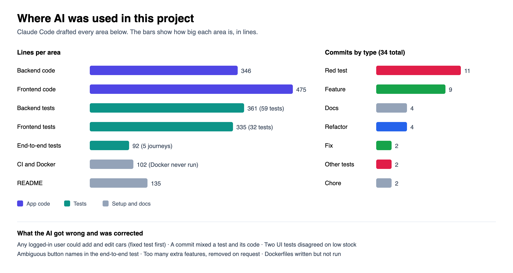

# Showroom: Car Dealership Inventory System

A car dealership inventory app built for a TDD kata. Shoppers log in, search the stock and buy cars. Admins add, edit, delete and restock them. Every feature started as a failing test.

**Stack:** Node.js and TypeScript with Express, SQLite and JWT on the backend. React, Vite and Tailwind CSS on the frontend. Vitest, Supertest, Testing Library and Playwright for tests.

| Admin dashboard | Search for in-stock SUVs |
| --- | --- |
|  |  |

More screenshots: [login](docs/screenshots/01-login.png), [shopper view](docs/screenshots/02-dashboard-user.png), [add vehicle form](docs/screenshots/04b-add-vehicle.png), [mobile](docs/screenshots/05-mobile.png).

## What the brief asked for and where it lives

| Requirement | Where |
| --- | --- |
| Register and login with JWT | `backend/src/auth.ts` |
| Vehicle CRUD and `GET /search` | `backend/src/vehicles.ts` |
| Purchase lowers stock, restock raises it (admin only) | `backend/src/vehicles.ts` |
| Admin only: add, update, delete, restock | `requireAdmin` in `backend/src/auth.ts` |
| A real database | SQLite file, tables in `backend/src/db.ts` |
| React app with Tailwind, search, Purchase disabled at 0 stock, admin forms | `frontend/src/` |
| Responsive layout | [mobile screenshot](docs/screenshots/05-mobile.png) |

## How the code is organised

```
backend/src
  server.ts     starts the API
  app.ts        middleware, routes and the error handler
  db.ts         creates the users and vehicles tables
  auth.ts       register, login, token check, admin check
  vehicles.ts   list and search, add, update, delete, purchase, restock
  errors.ts     one error class and one error handler
  seed.ts       demo data
frontend/src
  App.tsx           login page or dashboard
  AuthForm.tsx      login and register form
  Dashboard.tsx     search bar, car grid, add and edit popup, messages
  VehicleCard.tsx   one car with its Purchase and admin buttons
  VehicleForm.tsx   the add and edit popup
  api.ts            every call to the backend
```

Each section of the code starts with a one-line comment in capitals, like `PURCHASE BUTTON` or `ADMIN CHECK`, so it is easy to find.

Purchase is a single SQL statement: `UPDATE vehicles SET quantity = quantity - 1 WHERE id = ? AND quantity > 0`. The stock check and the change happen together inside the database, so stock cannot drop below zero. A test sends 20 buyers at 5 cars at once and expects exactly 5 to succeed.

## Run it

You need **Node 22.5 or newer**, because the app uses the built-in `node:sqlite`.

```bash
npm run install:all     # installs backend, frontend and e2e dependencies

npm run dev:api         # terminal 1: API on port 4000, creates dealership.db
npm run seed            # optional: 16 cars plus admin and shopper accounts
npm run dev:web         # terminal 2: web app on port 5173
```

Open http://localhost:5173. The first account you register becomes the admin. The seed script also creates `admin@showroom.dev` and `shopper@showroom.dev`, both with the password `password123`.

Backend settings, all optional while developing: `PORT` (4000), `DB_PATH` (`dealership.db`), `CORS_ORIGIN` (`*`) and `JWT_SECRET`. In production `JWT_SECRET` is required and the server will not start without it.

Docker: `docker-compose.yml` and two Dockerfiles are in the repo, but I never built or ran them because Docker was not running on my machine. Treat them as untested.

## API

Every `/api/vehicles` route needs the header `Authorization: Bearer <token>`. Errors look like `{ "error": "Vehicle is out of stock", "code": "OUT_OF_STOCK" }`.

| Method | Route | Who | Notes |
| --- | --- | --- | --- |
| POST | `/api/auth/register` | anyone | Body `{email, password}`. Returns `{token, user}`. `409` if the email is taken |
| POST | `/api/auth/login` | anyone | Same `401` for an unknown email and a wrong password. `429` after too many tries |
| GET | `/api/vehicles` and `/api/vehicles/search` | logged in | Filters: `make`, `model`, `category`, `minPrice`, `maxPrice`, `available` |
| POST | `/api/vehicles` | admin | Body `{make, model, category, price, quantity}` |
| PUT | `/api/vehicles/:id` | admin | Only the fields you send change |
| DELETE | `/api/vehicles/:id` | admin | Returns `204` |
| POST | `/api/vehicles/:id/purchase` | logged in | `409` when out of stock |
| POST | `/api/vehicles/:id/restock` | admin | Body `{amount}` |
| GET | `/api/health` | anyone | Checks the server and the database |

## Tests

```bash
npm test            # backend and frontend
npm run test:e2e    # Playwright in Chrome against the real API and a throwaway database
npm run test:all    # typecheck plus everything
```

### Test report

| Suite | Tests | Statements | Branches | Functions | Lines |
| --- | --- | --- | --- | --- | --- |
| Backend (Supertest, real SQLite) | 59 passing | 96.5% | 91.7% | 100% | 96.3% |
| Frontend (Testing Library) | 32 passing | 91.0% | 92.2% | 79.7% | 94.7% |
| End to end (Playwright, Chrome) | 5 passing | n/a | n/a | n/a | n/a |

Full output: [backend](docs/test-report-backend.txt), [frontend](docs/test-report-frontend.txt), [e2e](docs/test-report-e2e.txt). The backend tests use a fresh in-memory SQLite database per test to stay fast. The running app always uses a file. GitHub Actions runs all of this on every push.

### TDD history

A `test(red)` commit adds tests that I saw fail. The next commit makes them pass. Run `git log --oneline` to see the order.

The history also shows features I built and then removed: an audit trail, pagination, sorting, OpenAPI docs, URL-synced filters and toast messages. They went beyond the brief and made the code harder to explain, so the last two `refactor` commits take them out. The required behaviour and its tests did not change.

## Not built

Refresh tokens, password reset, a screen for promoting users to admin, pagination, sorting, payments.

## My AI Usage

I used Claude Code (Claude Sonnet 5.5) for this whole project. The chat is in [PROMPTS.md](PROMPTS.md). The commits have no `Co-authored-by` trailer, so this section is where AI use is recorded.



| Area | What the AI did |
| --- | --- |
| Backend API | Wrote the routes, SQL and input validation, one failing test at a time |
| Backend tests | Listed edge cases such as negative stock, admin-only routes and simultaneous buyers, then wrote them as failing tests before any code |
| Frontend | Wrote the React components and the Tailwind design |
| Frontend and end-to-end tests | Wrote the Testing Library tests and the Playwright journeys |
| Setup | Wrote the CI workflow, the Dockerfiles, the screenshots script and the test reports |
| Refactoring | Split the code into layers, then flattened it again when I asked for code simple enough to explain |

**What the AI got wrong**

1. The first version let any logged-in user add and edit cars. The brief labels only delete and restock as admin-only, but its UI section gives admins add and update as well. A failing test came first, then the fix.
2. One commit labelled as a red test also held the code that made it pass. The local history was rewritten so red and green are separate commits.
3. Two UI tests disagreed about what counts as low stock.
4. The first end-to-end run failed because "Register" matched two buttons on the page.
5. It built far more than the brief needed. I asked for simpler code and the extras were removed.
6. While simplifying, it set a development secret that was too short for its own startup check, so the server would not start. The end-to-end run caught it. It then wrote a first fix that would have let production run on the development secret, and corrected that too.
7. It wrote Docker files it could not run.
