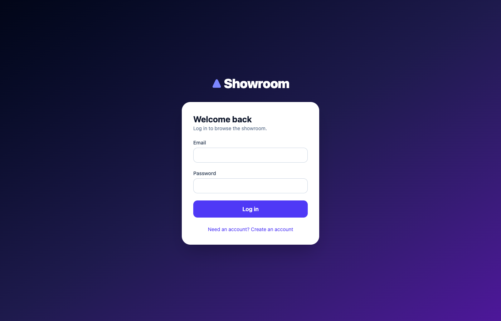
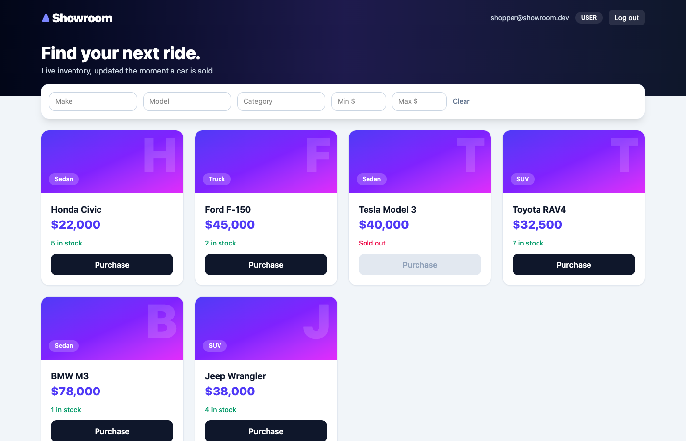
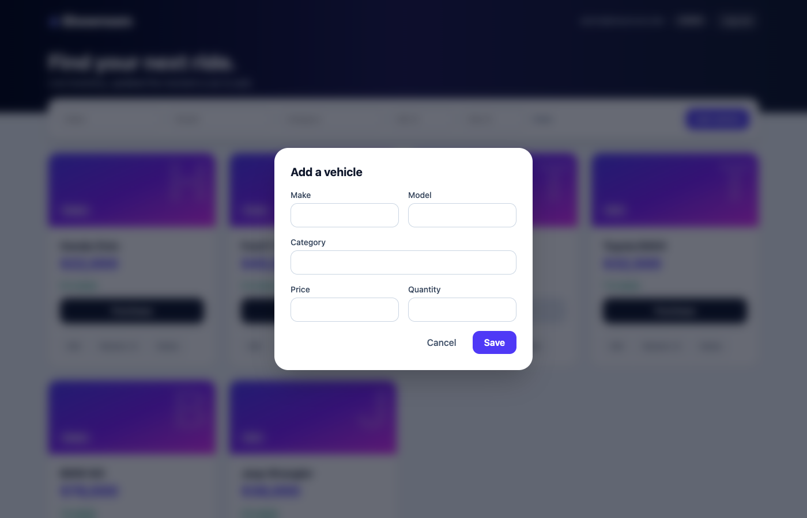
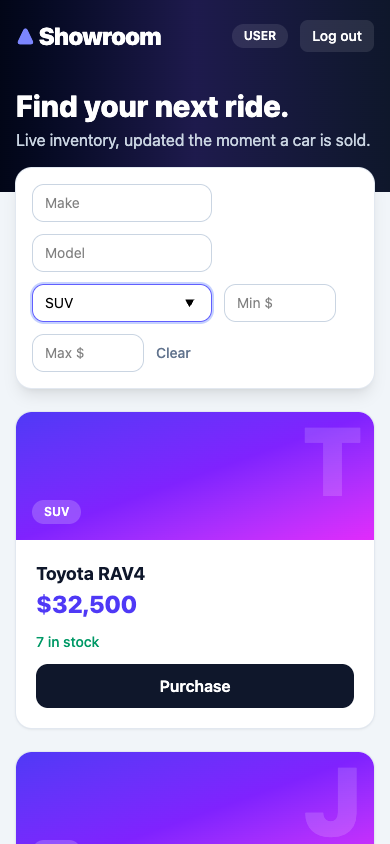

# Showroom: Car Dealership Inventory System

A full-stack inventory app for a car dealership, built test-first as a TDD kata.

- **Backend:** Node.js + TypeScript, Express 5, SQLite (Node's built-in `node:sqlite`, file-backed), JWT auth, Zod validation.
- **Frontend:** React + TypeScript (Vite), Tailwind CSS v4, responsive SPA.
- **Tests:** Vitest + Supertest (API), Vitest + Testing Library (UI). 76 tests, all green.

## Features

| Area | What it does |
| --- | --- |
| Auth | Register / log in, bcrypt-hashed passwords, 8h JWTs. **The first registered user becomes `admin`**; everyone after is a `user`. |
| Browse | Dashboard of all vehicles with live stock. |
| Search | Filter by make, model, category, and min/max price (combinable). |
| Purchase | Any user; the button is disabled at zero stock. The API decrements atomically (never negative, `409` when sold out). |
| Admin | Add, edit, delete vehicles and restock (+5 in the UI, any amount via the API). |

## API

All `/api/vehicles*` routes need `Authorization: Bearer <token>`.

| Method | Route | Access | Notes |
| --- | --- | --- | --- |
| POST | `/api/auth/register` | public | `{email, password(8+)}` → `{token, user}`; `409` on duplicate email |
| POST | `/api/auth/login` | public | same response; identical `401` for unknown email / wrong password |
| POST | `/api/vehicles` | user | `{make, model, category, price, quantity}` |
| GET | `/api/vehicles` | user | list all |
| GET | `/api/vehicles/search` | user | `?make=&model=&category=&minPrice=&maxPrice=` (case-insensitive, partial match) |
| PUT | `/api/vehicles/:id` | user | partial update |
| DELETE | `/api/vehicles/:id` | **admin** | `204` |
| POST | `/api/vehicles/:id/purchase` | user | quantity − 1, `409` if out of stock |
| POST | `/api/vehicles/:id/restock` | **admin** | `{amount}` positive integer |

## Run locally

Requires **Node 22.5+** (uses the built-in `node:sqlite`; developed on Node 26).

```bash
# terminal 1: API on :4000
cd backend
npm install
npm run dev            # creates dealership.db on first run

# terminal 2: web on :5173 (proxies /api to :4000)
cd frontend
npm install
npm run dev
```

Open http://localhost:5173 and register. The first account is the admin.

Environment variables (backend, all optional in dev): `PORT` (4000), `DB_PATH` (`dealership.db`), `JWT_SECRET` (**required** when `NODE_ENV=production`).

## Tests

```bash
cd backend  && npm test            # or: npm run test:coverage
cd frontend && npm test            # or: npm run test:coverage
```

### Test report

| Suite | Files | Tests | Statements | Branches | Functions | Lines |
| --- | --- | --- | --- | --- | --- | --- |
| Backend (API) | 2 | 48 ✅ | 98.3% | 93.8% | 100% | 98.2% |
| Frontend (UI) | 5 | 28 ✅ | 93.2% | 86.5% | 84.7% | 93.5% |

Raw output: [`docs/test-report-backend.txt`](docs/test-report-backend.txt), [`docs/test-report-frontend.txt`](docs/test-report-frontend.txt).
API tests run against an isolated in-memory SQLite database per test for speed; the running app always uses a file-backed database.

### TDD history

The git log follows Red → Green: each `test(red): …` commit adds failing specs, and the next `feat:` / `fix:` commit makes them pass.

```
chore: scaffold backend
test(red): auth register/login behaviour          → feat: implement register/login (green)
test(red): vehicle CRUD, search, purchase, restock → feat: implement vehicle routes (green)
test(red): malformed JSON body should be a 400    → fix: map malformed JSON body to 400 (green)
test(red): frontend specs (card, auth, dashboard) → feat: implement React UI (green)
```

## Design decisions

- **Dependency injection for the DB** (`createApp(db, config)`): tests get an isolated database; the server wires the real file.
- **Atomic purchase:** one conditional `UPDATE … WHERE quantity > 0`, so concurrent purchases cannot oversell.
- **Search safety:** parameterised SQL with `%`/`_` escaped, so user input is matched literally.
- **No account enumeration:** login returns the same `401` for unknown email and wrong password.
- **Roles from the server only:** a client can never choose its own role at registration.
- Known simplifications: no refresh tokens, no search debounce, no pagination (fine for a dealership-sized catalogue).

## Screenshots

| | |
| --- | --- |
|  |  |
|  |  |
|  |  |

## My AI Usage

**Tool:** Claude Code (Anthropic's CLI agent, model Claude Sonnet 5.5). Every commit that involved it carries a `Co-Authored-By` trailer.

**How I used it**

- Scaffolding: project setup, TypeScript/Vitest/Tailwind configuration, the Vite API proxy.
- Test design: enumerating edge cases (auth, validation, 403/404/409, negative stock, SQL wildcard input) and drafting the specs **before** the implementation, then confirming each suite failed (red) before implementing (green).
- Implementation: Express routers/middleware and the React components with Tailwind styling, then review of the generated code (atomic purchase, LIKE escaping, stale-response guard in search, role-gated UI).
- Screenshots: scripted with headless Chrome against a seeded demo database.

**Reflection**

AI was fastest at boilerplate and at brainstorming edge cases I would otherwise have found late. The red/green discipline kept the generated code honest: a failing test first meant every generated function had a stated purpose. What still needed a human was judgement: deciding the first-user-is-admin rule, insisting on identical login errors, and checking that the purchase path could not oversell. I treated its output as a draft to read critically rather than something to accept wholesale.

Full prompts are in [PROMPTS.md](PROMPTS.md).
