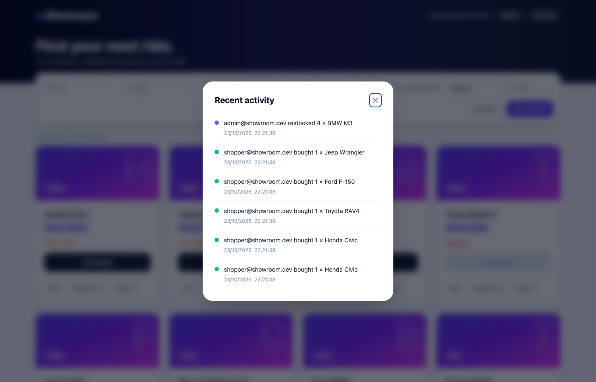
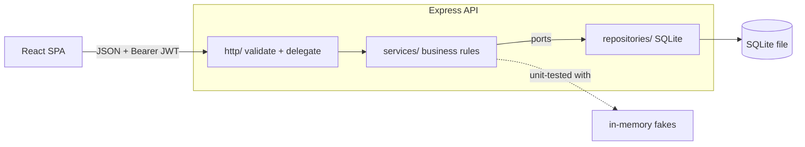

# Showroom: Car Dealership Inventory System

A full-stack inventory app for a car dealership, built test-first as a TDD kata. Customers browse, search and buy; admins manage the catalogue and see exactly who bought or restocked what.

**Stack:** Node.js + TypeScript, Express 5, SQLite (file-backed), JWT, Zod · React 19 + TypeScript, Vite, Tailwind CSS v4 · Vitest, Supertest, Testing Library, Playwright.

| | |
| --- | --- |
|  |  |

## What the brief asked for, and where it lives

| Requirement | Where / how |
| --- | --- |
| Register + login, JWT-protected routes | `backend/src/services/authService.ts`, `http/middleware.ts` |
| `POST/GET/PUT/DELETE /api/vehicles`, `GET /search` | `backend/src/http/vehicleRoutes.ts` |
| `purchase` (decrease) and `restock` (increase, admin) | `services/inventoryService.ts`, atomic SQL in `repositories/sqliteVehicleRepository.ts` |
| Admin-only: delete, restock, **and add/update** | The brief's UI section gives admins add/update/delete, so the API enforces it too (see "A bug I caught" below) |
| Real database (not in-memory) | SQLite file via Node's built-in `node:sqlite` ([ADR 1](docs/adr/0001-sqlite-via-node-builtin.md)) |
| React SPA, Tailwind, search/filter, disabled Purchase at 0, admin forms | `frontend/src/` |
| Responsive and creative design | see screenshots; mobile layout included |
| TDD with a visible Red → Green → Refactor history | see [TDD history](#tdd-history) |
| SOLID, clean code | [ADR 2](docs/adr/0002-layers-and-ports.md) |
| README, screenshots, test report, "My AI Usage", `PROMPTS.md` | here |

### Beyond the brief (deliberate extras)

- **Audit trail.** Every purchase/restock is recorded in the same transaction as the stock change (who, what, how many, when). History survives deleting a vehicle. Admin "Activity" panel + `GET /api/inventory/events`.
- **Never oversells.** One conditional `UPDATE … WHERE quantity + ? >= 0`; a test fires 20 simultaneous buyers at 5 cars ([ADR 4](docs/adr/0004-atomic-stock-and-audit-trail.md)).
- **Search that scales.** Sort, in-stock filter, pagination (`limit`/`offset`, total in `X-Total-Count`), `LIKE` wildcards escaped, sort column from a closed enum.
- **Filters live in the URL** (`/?category=SUV&available=1&sort=price:asc`): shareable, refresh-proof, debounced.
- **Security hygiene.** bcrypt, startup-validated config, rate-limited auth, helmet, same error and same timing for unknown email vs wrong password ([ADR 5](docs/adr/0005-security-and-error-contract.md)).
- **Living API docs.** OpenAPI at `/api/openapi.json`, Swagger UI at `/api/docs`; a contract test fails if a documented route doesn't exist.
- **UX craft.** Loading skeletons, toasts (errors announced via `role="alert"`), in-app confirm dialog focused on *Cancel*, Escape closes modals, double-click-proof buttons, low-stock warnings, empty/error states with retry.
- **Delivery.** `npm run seed`, GitHub Actions CI (typecheck + unit + coverage + Playwright), Dockerfiles + compose.

## Architecture



`domain.ts` holds the types, `DomainError` codes and the interfaces the services depend on; `app.ts` is the only place that picks concrete implementations. Six short [decision records](docs/adr/) explain the non-obvious choices.

## Run it

Requires **Node 22.5+** (developed on Node 26) for the built-in `node:sqlite`.

```bash
npm run install:all          # backend, frontend and e2e dependencies

# terminal 1: API on :4000 (creates dealership.db)
npm run dev:api
# optional demo data: 16 vehicles + admin@showroom.dev / shopper@showroom.dev (password123)
npm run seed

# terminal 2: web on :5173 (proxies /api to :4000)
npm run dev:web
```

Open http://localhost:5173. **The first account you register becomes the admin** ([ADR 3](docs/adr/0003-first-user-is-admin.md)), or use the seeded `admin@showroom.dev`. API docs: http://localhost:4000/api/docs.

Backend env (all optional in dev): `PORT` (4000), `DB_PATH` (`dealership.db`), `CORS_ORIGIN` (`*`), `JWT_SECRET` (**required, 32+ chars, when `NODE_ENV=production`**).

**Docker** (`docker-compose.yml` + two Dockerfiles): written but **not built or run by me**. The Docker daemon wasn't available on my machine, so treat it as untested.

## API

All `/api/vehicles*` and `/api/inventory*` routes need `Authorization: Bearer <token>`. Errors are `{ "error": "...", "code": "OUT_OF_STOCK" }`. Full schema: Swagger UI.

| Method | Route | Access | Notes |
| --- | --- | --- | --- |
| POST | `/api/auth/register` | public | `{email, password}` → `{token, user}`; `409` duplicate |
| POST | `/api/auth/login` | public | identical `401` for unknown email / wrong password; `429` when rate limited |
| GET | `/api/vehicles` · `/api/vehicles/search` | user | `make model category minPrice maxPrice available sort order limit offset` |
| POST | `/api/vehicles` | **admin** | `{make, model, category, price, quantity}` |
| PUT | `/api/vehicles/:id` | **admin** | partial update |
| DELETE | `/api/vehicles/:id` | **admin** | `204`; sales history is kept |
| POST | `/api/vehicles/:id/purchase` | user | optional `{quantity}` (default 1); `409 OUT_OF_STOCK` |
| POST | `/api/vehicles/:id/restock` | **admin** | `{amount}` |
| GET | `/api/inventory/events` | **admin** | audit trail, newest first |
| GET | `/api/health` | public | liveness + DB check |

## Tests

```bash
npm test            # backend + frontend unit/integration
npm run test:e2e    # Playwright in real Chrome against the real API and a throwaway DB
npm run test:all    # typecheck + everything
```

### Test report

| Suite | Tests | Statements | Branches | Functions | Lines |
| --- | --- | --- | --- | --- | --- |
| Backend: service units + API (Supertest, real SQLite) | **113** ✅ | 95.1% | 90.3% | 100% | 95.5% |
| Frontend: components + client (Testing Library) | **45** ✅ | 93.9% | 89.6% | 86.8% | 96.3% |
| End-to-end (Playwright, Chrome) | **5** ✅ | n/a | n/a | n/a | n/a |

Raw output: [backend](docs/test-report-backend.txt) · [frontend](docs/test-report-frontend.txt) · [e2e](docs/test-report-e2e.txt). The uncovered lines are mostly defensive branches (toast dismiss, load-more failure, the seed CLI guard). API tests use an isolated in-memory SQLite per test for speed; the running app always uses a file.

### TDD history

Each `test(red)` commit adds specs that I ran and watched fail; the next commit makes them pass; `refactor` changes structure with the suite untouched.

```
test(red):  auth register/login               → feat: JWT auth + SQLite (green)
test(red):  vehicle CRUD, search, purchase    → feat: vehicle routes (green)
test(red):  malformed JSON is a 400           → fix: map to 400 (green)
test(red):  only admins add/update vehicles   → fix: require admin (green)        ← bug found in review
test(red):  service-level specs + fakes       → refactor: layers and ports        ← the Refactor step
test(red):  multi-unit buy, concurrency, audit→ feat: transactional audit trail (green)
test(red):  availability, sort, pagination    → feat: listing features (green)
test(red):  config, health, headers, limits   → feat: hardening (green)
test(red):  OpenAPI contract, seed            → feat: docs + seed (green)
test(red):  frontend UX specs                 → feat: debounce, URL filters, toasts… (green)
```

(`git log --oneline` shows the real sequence.)

## Things I deliberately did not build

Refresh tokens/revocation, password reset, a promote-to-admin screen, an ORM, GraphQL, a DI container, caching, a Redis-backed rate limiter, optimistic UI updates, payments. Each is a real feature for a real product; none earns its complexity in this scope, and the ADRs say where each would plug in.

## My AI Usage

**Tool:** Claude Code (Anthropic's CLI agent, Claude Sonnet 5.5). Every AI-assisted commit has a `Co-Authored-By` trailer. The full prompts are in [PROMPTS.md](PROMPTS.md).

**How I used it**

- **Test-first pairing.** I used it to enumerate edge cases (negative stock, SQL wildcard input, refused purchases not being logged, history surviving deletes), wrote them as failing specs first, and only then let it implement. A failing run was the gate before every implementation.
- **Design decisions were mine; typing was shared.** I chose the port boundaries, first-user-is-admin, the audit-trail model and what *not* to build. AI did the mechanical moves (the refactor into layers) and drafted components and Tailwind markup.
- **AI as a skeptical reviewer.** After the first working version I asked it to critique the UI like a senior reviewer; the list (no loading state, `window.confirm`, a request per keystroke, filters lost on refresh, double-click buys twice) became the frontend specs.
- **Tooling.** Scaffolding configs, Playwright setup, and a headless-Chrome script for the screenshots.

**Where it was wrong, and how I caught it** (all real, all in the history)

1. The first generated router let *any* logged-in user add and edit vehicles, so a shopper could reprice a car. Only delete/restock were admin-gated, because those were the only ones the brief labelled "Admin only". Re-reading the brief's UI section showed add/update are admin features too. I wrote the failing test first, then fixed it.
2. It put a feature implementation into a commit labelled as a red test. I rewrote the local history so the red/green sequence is honest.
3. One of its UI specs asserted two contradictory low-stock thresholds. I noticed when the green run failed and fixed the spec, not the code.
4. The first end-to-end run failed on ambiguous button names ("Register" also matched "Already registered? Log in"). That's a real accessibility smell, so I made the selectors exact.
5. It wrote Docker files I could not run. I say so above instead of claiming they work.

**Reflection.** AI was strongest at breadth: edge-case lists, boilerplate, mechanical refactors, and a second pair of eyes. It was weakest at reading intent: it implemented what the brief literally labelled rather than what it implied (the admin gap), and it happily produced plausible-looking structure with no one asking "does this have to exist?". The workflow that worked was tests as the contract, small commits, and treating every generated diff as a pull request from a fast junior: read it, run it, and distrust the confident parts. The red/green discipline also made AI's mistakes cheap to find, because a wrong assumption shows up as a failing test rather than a production bug.
